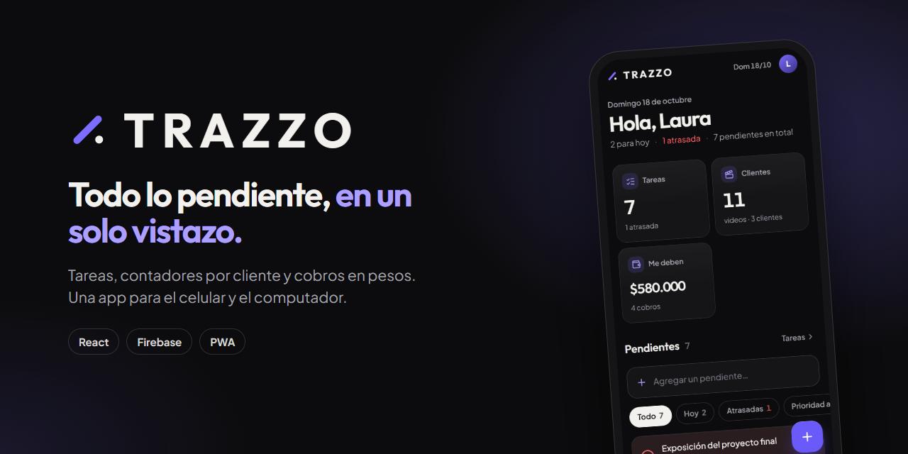
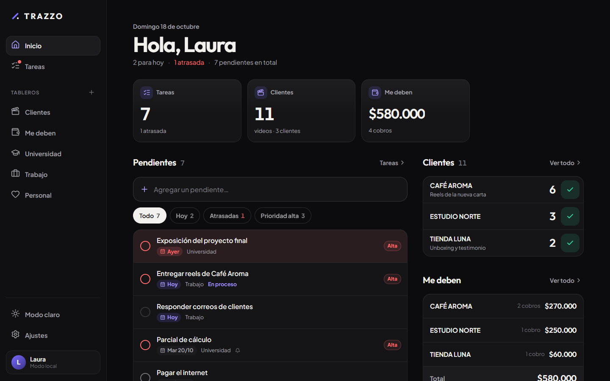
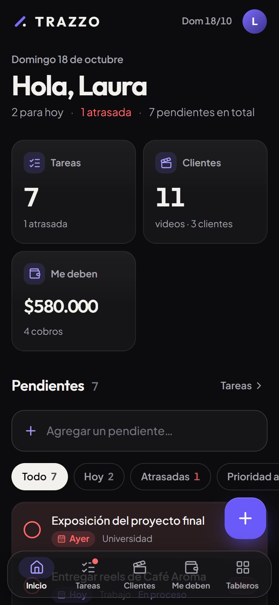
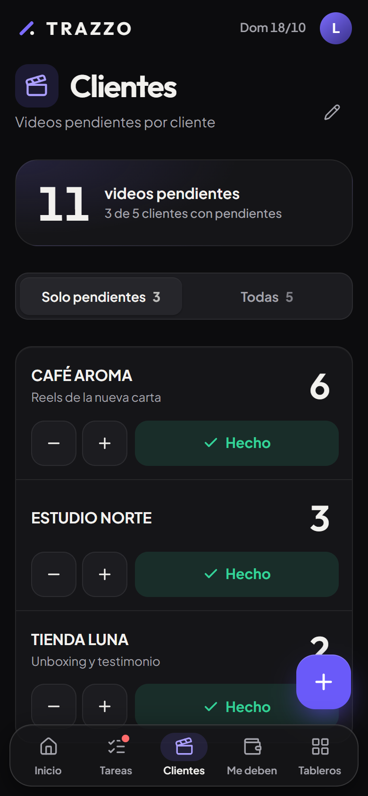
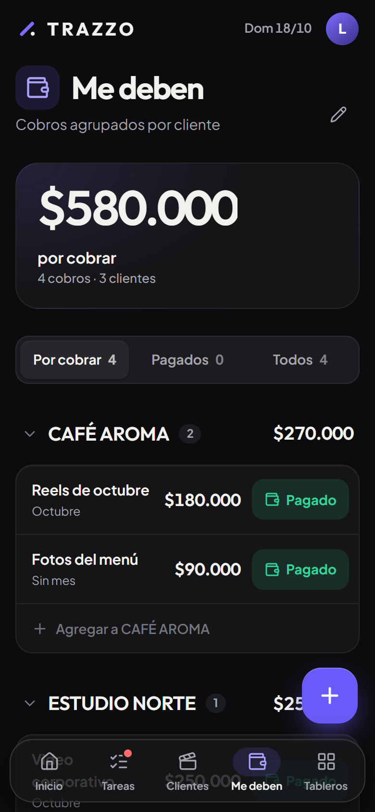
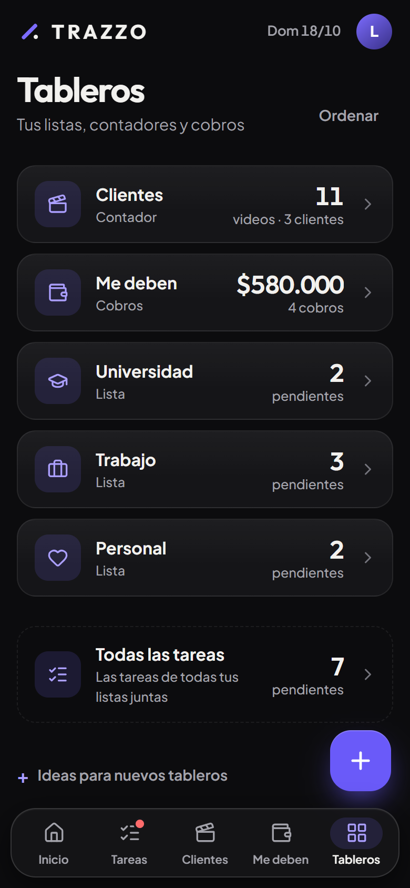
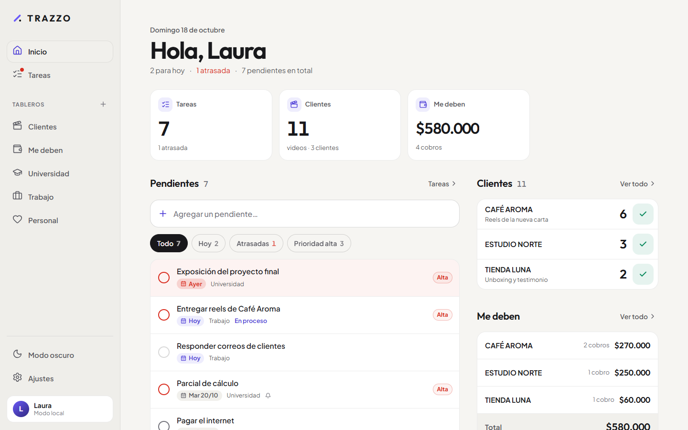
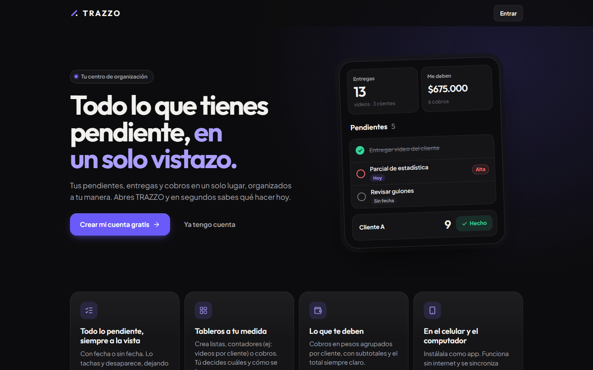

<p align="center">
  
</p>

<p align="center">
  <strong>Tu centro de organización.</strong><br>
  Tareas, contadores por cliente y cobros en pesos, en una app que se instala en el celular.
</p>

<p align="center">
  
  
  
  
  
</p>

---

## ✨ ¿Qué es TRAZZO?

TRAZZO es una app para saber **en segundos** qué tienes que hacer hoy, qué está atrasado, cuántas entregas debes
y cuánto dinero te deben.

La idea es simple: **lo pendiente siempre está a la vista**, tenga fecha límite o no. Cuando lo marcas como hecho,
se tacha, desaparece y deja espacio para lo siguiente.

Nació para el día a día de un editor de video freelance que también estudia, pero no trae nada fijo:
**cada persona arma sus propios tableros**.

## 📸 Capturas

<p align="center">
  
</p>

<p align="center">
  
  &nbsp;
  
  &nbsp;
  
  &nbsp;
  
</p>

<details>
<summary><strong>Ver modo claro y página de inicio</strong></summary>
<br>

<br><br>

</details>

## 🧩 Tableros: tu app, a tu manera

Solo **Inicio** y **Tareas** vienen fijos. Todo lo demás lo creas tú, con el nombre y el ícono que quieras:

| Tipo | Para qué sirve | Ejemplos |
|:--|:--|:--|
| ✅ **Lista** | Pendientes que tachas al terminarlos | Universidad · Personal · Trabajo |
| 🔢 **Contador** | Un número por fila que baja con el botón **Hecho** | Videos por marca · Pedidos por cliente |
| 💰 **Cobros** | Lo que te deben, agrupado por persona, en pesos | Me deben · Facturas |

En un contador tú decides las palabras: si escribes *“marca”* y *“videos”*, la app dice
**“13 videos pendientes en 3 marcas”** y el botón dice **“Nueva marca”**.

## 🚀 Funciones

- **Inicio de un vistazo:** números grandes, pendientes ordenados por urgencia (atrasadas → hoy → prioridad),
  tus contadores con botón **Hecho** y lo que te deben por cliente.
- **Un clic para todo:** marcar hecho, restar un video, marcar pagado… siempre con **Deshacer**.
- **Agregar rápido:** escribes el pendiente, presionas Enter y listo. Fecha y prioridad son opcionales.
- **Semana tipo calendario:** tira de días en el celular, 7 columnas en el computador.
- **Cobros en COP:** escribe `105` y se guarda **$105.000**. Agrupados por cliente, con subtotales y total general.
- **Recordatorios:** notificaciones del navegador y botones para enviar la tarea a **Google Calendar** o al
  calendario del celular (`.ics`).
- **Instalable (PWA):** se abre como app desde la pantalla de inicio y funciona sin internet.
- **En la nube:** inicio de sesión con Google o correo, y los mismos datos en el celular y el computador.
- **Copia de seguridad:** exporta e importa todos tus datos en un archivo `.json`.
- **Modo oscuro y claro**, diseño pensado primero para el celular, fechas en hora de Colombia (`dd/mm/aaaa`).

## 🛠️ Tecnologías

| | |
|:--|:--|
| **Interfaz** | [React 19](https://react.dev) + [Vite 8](https://vite.dev) |
| **Animaciones** | [Motion](https://motion.dev) |
| **Íconos** | [Lucide](https://lucide.dev) |
| **Tipografías** | Outfit + Plus Jakarta Sans |
| **Cuenta y datos** | [Firebase](https://firebase.google.com) Authentication + Cloud Firestore (con copia sin conexión) |
| **App instalable** | [vite-plugin-pwa](https://vite-pwa-org.netlify.app) |
| **Publicación** | [Netlify](https://www.netlify.com) |

## 💻 Correr en tu computador

Necesitas [Node.js](https://nodejs.org) **20.19 o más nuevo**.

```bash
git clone https://github.com/TU-USUARIO/trazzo.git
cd trazzo
npm install
npm run dev
```

Abre **http://localhost:5173**.

| Comando | Qué hace |
|:--|:--|
| `npm run dev` | Abre la app en modo desarrollo |
| `npm run celular` | Igual, pero accesible desde el celular en la misma red Wi‑Fi |
| `npm run build` | Construye la versión final en la carpeta `dist` |
| `npm run preview` | Muestra la versión final para probarla |

> 💡 Si `src/firebase/config.js` está vacío, TRAZZO funciona en **modo local**: los datos se guardan solo en ese
> navegador y no hace falta cuenta. Ideal para probarla.

## 🔥 Firebase

1. Crea un proyecto en [console.firebase.google.com](https://console.firebase.google.com) y registra una app **Web**.
2. Copia los datos que te da Firebase en [`src/firebase/config.js`](src/firebase/config.js).
3. **Authentication:** activa *Correo electrónico/contraseña* y *Google*.
4. **Firestore Database:** créala en modo producción y pega las reglas de [`firestore.rules`](firestore.rules).

Los datos de cada persona se guardan en `usuarios/{uid}/…` y las reglas solo le permiten leer y escribir
**sus propios** datos. La configuración web de Firebase no es secreta: lo que protege la información son esas reglas.

La guía paso a paso, en español y sin tecnicismos, está en [**LEEME.md**](LEEME.md).

## 🌐 Publicar en Netlify desde GitHub

1. Sube el proyecto a un repositorio de GitHub.
2. En [app.netlify.com](https://app.netlify.com): **Add new site → Import an existing project → GitHub** y elige el repositorio.
3. Netlify lee [`netlify.toml`](netlify.toml) y configura todo solo: comando `npm run build`, carpeta `dist` y Node 22.
   Toca **Deploy**.
4. En Firebase: **Authentication → Configuración → Dominios autorizados → Agregar dominio** y escribe tu dirección
   de Netlify (por ejemplo `trazzo.netlify.app`). Sin esto, el inicio de sesión no funciona en la versión publicada.

Desde ahí, **cada cambio que subas a GitHub se publica automáticamente**.

## 📱 Instalar en el celular

- **Android (Chrome):** abre tu dirección de Netlify → menú ⋮ → **Instalar app**. También desde *Ajustes → Instalar*.
- **iPhone (Safari):** abre la dirección → **Compartir** → **Agregar a inicio**.

## 📁 Estructura

```
src/
├── componentes/   piezas reutilizables (tarea, contador, cobro, semana, menú, editores…)
├── config/        configuración general, tipos de tablero y plantillas
├── contexto/      datos compartidos entre pantallas (sesión, datos, avisos, editores)
├── datos/         datos de ejemplo
├── estilos/       todo el diseño (tokens, base, estructura, componentes, pantallas)
├── firebase/      conexión con Firebase
├── hooks/         fecha de hoy, tema claro/oscuro
├── paginas/       Landing, Entrar, Inicio, Tareas, Tableros, Contadores, Cobros, Ajustes
├── servicios/     sesión, guardado (local / nube), recordatorios, copia de seguridad, instalar
└── utils/         fechas, pesos colombianos, palabras, calendario, reglas de tareas y tableros
```

## 🎨 Personalizar

| Quiero cambiar… | Dónde |
|:--|:--|
| El color de la app | `src/estilos/tokens.css` → `--acento` |
| Ideas de tableros (plantillas) | `src/config/app.js` → `PLANTILLAS` |
| Íconos disponibles | `src/componentes/Iconos.jsx` |
| Datos de ejemplo | `src/datos/ejemplo.js` |
| Textos de la página de presentación | `src/paginas/Landing.jsx` |
| Nombre e ícono al instalar | `vite.config.js` (manifest) y `public/` |

---

<p align="center">
  Hecho con 💜 en Colombia
</p>
